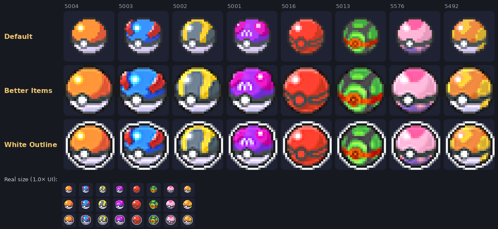
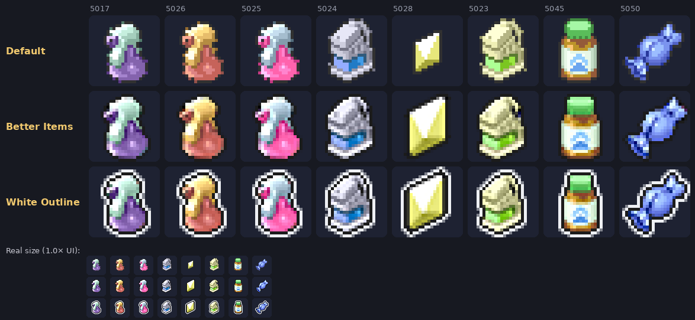
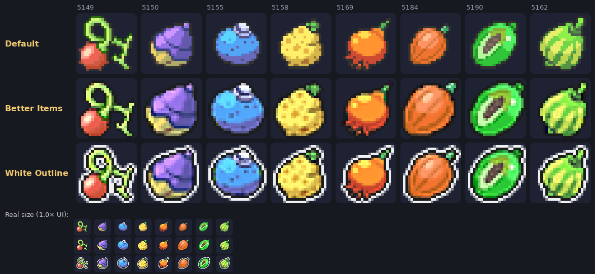
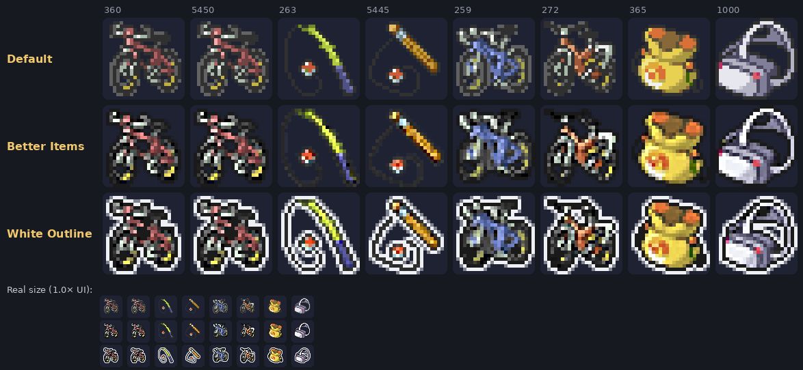
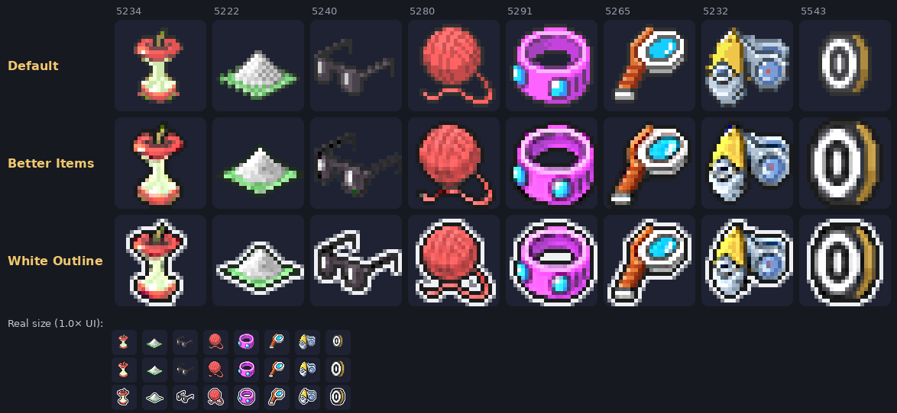
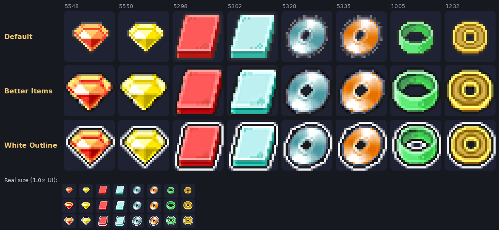
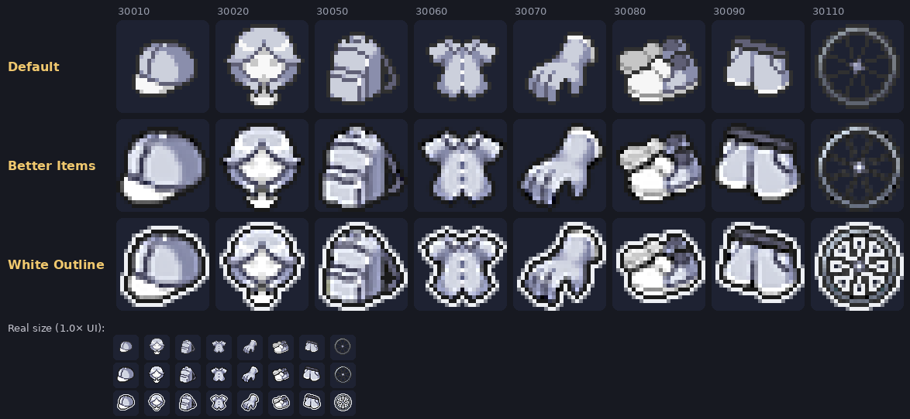

# Better Items

A PokeMMO item icon mod that refines the game's original artwork with cleaner edges, smoother shading and improved readability. The designs, colours, item IDs and file names stay familiar — just cleaner and easier to recognise.

**2,366 item icon files · 1,140 unique images · Two versions**

## Versions

Choose the version you prefer and install **only one**:

| Version | Outline | Best for |
|---|---|---|
| **Better Items** | Clean dark outline | A natural fit with the original interface and most themes |
| **Better Items White Outline** | Thin white outline | Extra visibility against darker windows |

Both versions contain the same icon improvements. Only the outline treatment differs.

## Features

- **Bigger icons:** artwork fills more of the available icon space. Poké Balls, for example, go from approximately 16 px to 23 px.
- **Cleaner edges:** smoother curves and diagonals instead of the original blocky appearance.
- **Improved shading:** smoother colour transitions while keeping small details crisp.
- **Better contrast:** solid outlines and a slight contrast lift make items easier to distinguish.
- **Preserved artwork:** original designs, colours, special outlines and small details are retained.
- **Complete coverage:** all 2,366 item icon files are included, covering 1,140 different images.

The goal is to improve the original artwork without making the items look like something completely different.

## Screenshots

A look at the refined item icons across different categories:

### Poké Balls

### Medicine

### Berries

### Key Items

### Held Items

### Gems, Plates & TMs

### Cosmetics

## Installation

1. Close PokeMMO.
2. Download your preferred .mod file from the [Releases](https://github.com/haqzo/better-items-/releases) page. **Do not unzip it.**
3. Copy the file into `<PokeMMO>/data/mods/`.
4. Start PokeMMO and open **Mod Management**.
5. Enable the mod, press **Save**, and restart the client.

Install **one version only**.

## Compatibility

- Works with any PokeMMO theme, including Better Default.
- Made for 1.0× UI scale.
- Tested at 1.0×, 1.25×, 1.5×, 1.75× and 2.0× UI scale.
- Tested across all 8 Bag pockets, Bag tab icons and the hotbar.
- Compatible with Dynamic Ocarinas by BlueQuilava (not included).

If using Dynamic Ocarinas and the original ocarina icons appear, adjust the mod order in Mod Management.

## Known issues

- **White Outline:** fishing rods and string-like items can look slightly loopy because the white outline follows both sides of their thin lines.
- **White Outline:** some icons that already fill their entire space are slightly smaller to make room for the outline.
- Android compatibility has not been tested.
- Shops, GTL, Battle Bag, PC and trade windows have not yet been checked.

## Credits

- **PokeMMO** — Original item artwork, refined and improved without outside artwork.
- **BlueQuilava** — [Dynamic Ocarinas](https://forums.pokemmo.com/index.php?/topic/200765-dynamic-ocarinas-improved-ocarina-icons/), supported but not included.

## Changelog

See [CHANGELOG.md](CHANGELOG.md) for the full version history.
